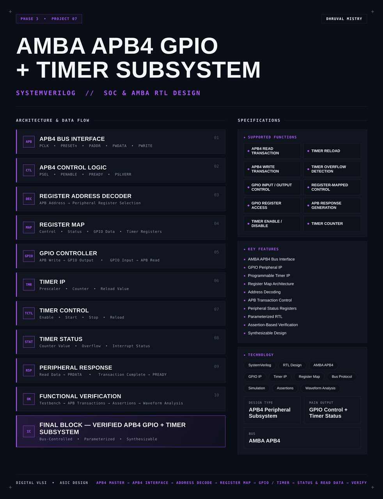
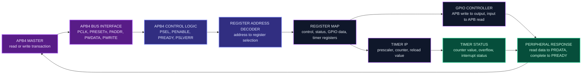
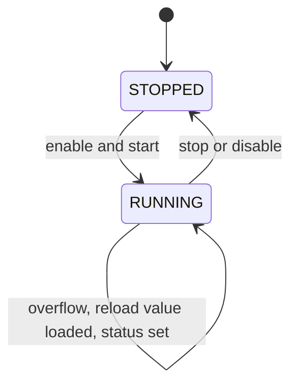
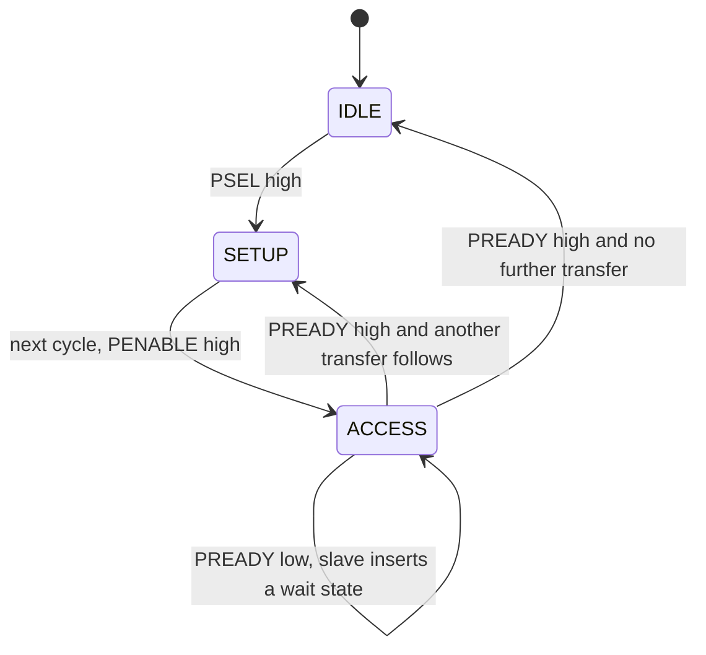
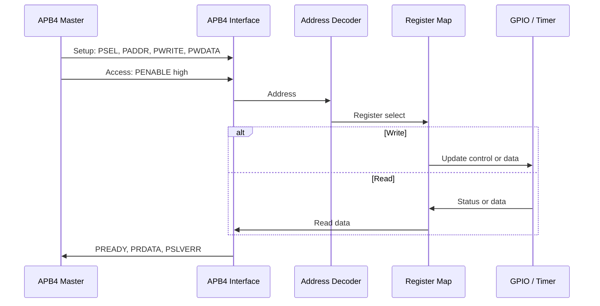
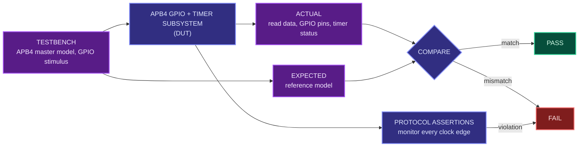

<div align="center">




<b>A synthesizable AMBA APB4 peripheral subsystem with a GPIO controller and a programmable timer behind a register map, written in SystemVerilog.</b>

<br/>


<br/>

[Overview](#overview) |
[At a Glance](#project-at-a-glance) |
[Background](#background-amba-apb-and-memory-mapped-peripherals) |
[Functions](#supported-functions) |
[Architecture](#architecture) |
[Functional Description](#functional-description) |
[APB4 Protocol](#apb4-protocol) |
[Register Map](#register-map) |
[Interface](#interface) |
[Operating Sequence](#operating-sequence) |
[Getting Started](#getting-started) |
[Verification](#verification) |
[Synthesis](#synthesis) |
[Applications](#applications) |
[FAQ](#faq) |
[License](#license)

</div>

---

## Overview

This project implements an **AMBA APB4 peripheral subsystem** in **SystemVerilog**. It contains two peripherals, a **GPIO controller** and a **programmable timer**, that sit behind one **APB4 bus interface** and are controlled by a processor or bus master through a **register map**.

The APB4 side receives **read and write transactions** from an APB4 master. **APB4 control logic** follows the protocol phases and generates the responses. A **register address decoder** turns the APB address into the selection of one peripheral register. Writes to registers configure the peripherals: they set GPIO outputs, enable or stop the timer, and load the reload value. Reads return the GPIO input state, the timer counter value and the status registers. A **peripheral response** block returns read data and tells the master when each transaction is complete.

The **GPIO controller** connects chip pins to the bus: an APB write drives a GPIO output and a GPIO input can be read back over APB. The **timer IP** contains a prescaler, a counter and a reload value, and reports overflow and interrupt status. The design is **parameterized**, written in a **synthesis-friendly** style, checked with a testbench that acts as an APB4 master, protocol **assertions** and waveform analysis, and packaged as a reusable SoC peripheral block.

<table>
<tr>
<td width="50%" valign="top">

#### Objectives
- Implement a slave that follows the AMBA APB4 protocol
- Map peripheral control and status into a register map
- Decode APB addresses to select the right register
- Build a GPIO controller with input and output control
- Build a programmable timer with prescaler, counter and reload
- Report timer overflow and interrupt status through registers
- Verify bus behavior and peripheral function with assertions

</td>
<td width="50%" valign="top">

#### Key Features
- AMBA APB4 bus interface
- GPIO peripheral IP
- Programmable timer IP
- Register map architecture
- Address decoding
- APB transaction control
- Peripheral status registers
- Parameterized RTL
- Assertion-based verification
- Synthesizable design

</td>
</tr>
</table>

---

## Project at a Glance

| Attribute | Detail |
|:--|:--|
| **Design type** | APB4 peripheral subsystem |
| **Description language** | SystemVerilog (RTL) |
| **Bus** | AMBA APB4 (slave side) |
| **Peripherals** | GPIO controller and programmable timer |
| **Control method** | Register-mapped, through APB read and write transactions |
| **Addressing** | Register address decoder |
| **Timer** | Prescaler, counter, reload value, enable and stop control |
| **Status** | Counter value, overflow and interrupt status |
| **Main output** | GPIO control and timer status |
| **Configurability** | Parameterized RTL |
| **Checking** | APB testbench, protocol assertions, waveform analysis |
| **Functions** | 12 (APB read and write, GPIO, timer, register mapping, response) |
| **Simulation** | Verilator |
| **Waveform analysis** | GTKWave |
| **Synthesis** | Yosys |
| **License** | MIT |

---

## Background: AMBA APB and Memory-Mapped Peripherals

Inside a system-on-chip, a processor does not control a peripheral by wiring directly to it. It reads and writes **registers** that sit at fixed addresses, and the bus carries those reads and writes to the right peripheral. This is called **memory-mapped I/O**. Writing a register configures or commands the peripheral, and reading a register returns its status or data.

**AMBA** (Advanced Microcontroller Bus Architecture) is a family of on-chip bus standards from Arm that is used throughout the industry. **APB** (Advanced Peripheral Bus) is the simplest member of the family, designed for low-bandwidth peripherals such as GPIO, timers, UARTs and configuration registers. It has no bursts and no pipelining. Every transfer takes at least two clock cycles and follows the same simple sequence, which keeps the interface small, low power and easy to verify. **APB4** is the version that adds the write strobes (`PSTRB`) and protection (`PPROT`) signals on top of the earlier APB3 definition.

In a typical SoC the processor sits on a fast bus. A bridge converts transfers from that bus to APB, and all the slow peripherals hang off the APB side. Each peripheral is an **APB slave**: it only responds when the master selects it.

This project builds such a slave. Two useful peripherals, GPIO and a timer, share one APB4 interface, so the design covers the full path from a bus transaction to a register, to peripheral behavior, and back to a response on the bus.

---

## Supported Functions

| Group | Function | Description |
|:--|:--|:--|
| **Bus** | `APB4 READ TRANSACTION` | Returns register data to the APB master |
| **Bus** | `APB4 WRITE TRANSACTION` | Stores APB write data into a register |
| **Bus** | `APB RESPONSE GENERATION` | Generates the ready and error responses for a transfer |
| **Control** | `REGISTER-MAPPED CONTROL` | Peripherals are controlled through addressable registers |
| **GPIO** | `GPIO INPUT / OUTPUT CONTROL` | Sets pin direction and drives the output |
| **GPIO** | `GPIO REGISTER ACCESS` | Reads and writes the GPIO registers over APB |
| **Timer** | `TIMER ENABLE / DISABLE` | Starts and stops the timer |
| **Timer** | `TIMER COUNTER` | Counts the prescaled clock |
| **Timer** | `TIMER RELOAD` | Loads the counter from the reload value |
| **Timer** | `TIMER OVERFLOW DETECTION` | Detects when the count completes and raises the status |

---

## Architecture

The design is organized as an APB4 bus interface, APB4 control logic, a register address decoder, a register map, the GPIO controller, the timer IP with its control and status, and a peripheral response block that returns read data and completes each transaction.

#### Block diagram

```text
                      +------------------------------------------------------------+
                      |                APB4 GPIO + TIMER SUBSYSTEM                 |
                      |                                                            |
  PCLK -------------->|                                                            |
  PRESETn ----------->|    +---------------------------------------------+         |
  PSEL -------------->|--->|                                             |         |
  PENABLE ----------->|--->|            APB4 CONTROL LOGIC               |         |
  PWRITE ------------>|--->|   PSEL / PENABLE / PREADY / PSLVERR         |         |
                      |    |   protocol phases and responses             |         |
                      |    +----------+----------------------+-----------+         |
                      |               | access               | response            |
  PADDR ------------->|--->+----------------------+          |                     |
                      |    | REGISTER ADDRESS     |          |                     |
                      |    | DECODER              |          |                     |
                      |    +----------+-----------+          |                     |
                      |               | register select      |                     |
  PWDATA ------------>|-------------->v                      |                     |
                      |    +----------------------------+    |                     |
                      |    |        REGISTER MAP        |    |                     |
                      |    |  control | status          |    |                     |
                      |    |  GPIO data | timer regs    |    |                     |
                      |    +-----+------------------+---+    |                     |
                      |          |                  |        |                     |
                      |          v                  v        |                     |
                      |   +-------------+    +-------------+ |                     |
                      |   |    GPIO     |    |  TIMER IP   | |                     |
                      |   | CONTROLLER  |    | prescaler   | |                     |
                      |   |             |    | counter     | |                     |
                      |   |             |    | reload      | |                     |
                      |   +------+------+    +------+------+ |                     |
                      |          |                  | status |                     |
                      |          v                  v        v                     |
                      |    +--------------------------------------------+          |
                      |    |            PERIPHERAL RESPONSE             |----------> PRDATA
                      |    |   read data -> PRDATA                      |----------> PREADY
                      |    |   transaction complete -> PREADY           |----------> PSLVERR
                      |    +--------------------------------------------+          |
                      +--------|-----------------------------------|---------------+
                               v                                   v
                    GPIO PINS (in / out)                  TIMER OVERFLOW / INTERRUPT
```

#### Data flow



#### Block breakdown

| # | Block | Role |
|:-:|:--|:--|
| `01` | **APB4 Bus Interface** | PCLK, PRESETn, PADDR, PWDATA and PWRITE from the master |
| `02` | **APB4 Control Logic** | PSEL, PENABLE, PREADY and PSLVERR handling |
| `03` | **Register Address Decoder** | Turns the APB address into a peripheral register selection |
| `04` | **Register Map** | Control, status, GPIO data and timer registers |
| `05` | **GPIO Controller** | APB write drives GPIO output, GPIO input is returned on APB read |
| `06` | **Timer IP** | Prescaler, counter and reload value |
| `07` | **Timer Control** | Enable, start, stop and reload |
| `08` | **Timer Status** | Counter value, overflow and interrupt status |
| `09` | **Peripheral Response** | Read data to PRDATA, transaction complete to PREADY |
| `10` | **Functional Verification** | Testbench, APB transactions, assertions and waveform analysis |

> **Final design block:** `APB4 MASTER -> APB4 INTERFACE -> ADDRESS DECODE -> REGISTER MAP -> GPIO / TIMER -> STATUS AND READ DATA`

---

## Functional Description

#### APB4 bus interface
The slave side of the APB4 bus. It receives the clock `PCLK`, the active-low reset `PRESETn`, the address `PADDR`, the write data `PWDATA` and the direction `PWRITE`. It returns read data on `PRDATA`. APB4 also defines the write strobes `PSTRB` and the protection signal `PPROT`. How this design uses them is listed in [Interface](#interface).

#### APB4 control logic
Follows the APB protocol. A transfer starts when the master raises `PSEL` and ends when the slave raises `PREADY` while `PENABLE` is high. The control logic detects the phases of the transfer, decides when a register write or read takes effect, and drives `PREADY` and `PSLVERR` back to the master. See [APB4 Protocol](#apb4-protocol).

#### Register address decoder
Takes the APB address and selects exactly one register. An address that does not belong to any register is an unmapped access, and the design handles it as described in the configuration table.

#### Register map
The set of registers through which the whole subsystem is controlled: control registers, status registers, the GPIO data registers and the timer registers. See [Register Map](#register-map).

#### GPIO controller
Connects the chip pins to the register map.
- **Output.** A write to the GPIO data register over APB drives the GPIO output pins.
- **Input.** The state of the GPIO input pins can be read through the GPIO data register over APB.
- **Direction.** A direction register decides, for each pin, whether it is an input or an output.

#### Timer IP
A programmable timer built from three parts:
- **Prescaler.** Divides the bus clock to give a slower count rate.
- **Counter.** Counts at the prescaled rate.
- **Reload value.** The value the counter is loaded with at the start and after each overflow, which sets the period.

#### Timer control
Controls the timer through register bits: enable and disable, start, stop and reload.



| State | Behavior |
|:--|:--|
| `STOPPED` | Counter holds its value and the timer does not count |
| `RUNNING` | Counter advances at the prescaled rate |
| Overflow event | Overflow status is set, the interrupt status is updated and the counter is reloaded |

#### Timer status
Reports the **counter value**, the **overflow** flag and the **interrupt status**. The master reads them over APB to find out what the timer is doing.

#### Peripheral response
Collects the read data from the selected register and returns it on `PRDATA`. It also signals that the transaction is complete through `PREADY`, and reports an error through `PSLVERR` if the access cannot be performed.

---

## APB4 Protocol

#### Signals

| Signal | Direction (slave) | Purpose |
|:--|:-:|:--|
| `PCLK` | Input | Bus clock, all transfers are timed against its rising edge |
| `PRESETn` | Input | Active-low reset |
| `PADDR` | Input | Address of the register being accessed |
| `PSEL` | Input | Selects this slave for a transfer |
| `PENABLE` | Input | Marks the second and later cycles of a transfer |
| `PWRITE` | Input | High for a write, low for a read |
| `PWDATA` | Input | Write data |
| `PSTRB` | Input | Write byte strobes (added in APB4) |
| `PPROT` | Input | Protection attributes (added in APB4) |
| `PRDATA` | Output | Read data |
| `PREADY` | Output | Slave is ready, ends the transfer |
| `PSLVERR` | Output | Slave error response |

#### Transfer phases

Every APB transfer goes through the same three states.



| Phase | PSEL | PENABLE | What happens |
|:--|:-:|:-:|:--|
| `IDLE` | 0 | 0 | No transfer in progress |
| `SETUP` | 1 | 0 | Address, direction and write data are presented. Lasts one clock cycle |
| `ACCESS` | 1 | 1 | The transfer completes when `PREADY` is high. If `PREADY` is low, the master waits |

#### Write transfer

```text
 PCLK      __|--|__|--|__|--|__|--|__|--|__
 PSEL      ______|------------------|______
 PENABLE   ___________|-------------|______
 PWRITE    ______|------------------|______
 PADDR     ======< register address >======
 PWDATA    ======< write data       >======
 PREADY    ___________|-------------|______
                 SETUP    ACCESS
```

The register is updated at the end of the access phase, in the cycle where `PSEL`, `PENABLE` and `PREADY` are all high.

#### Read transfer

```text
 PCLK      __|--|__|--|__|--|__|--|__|--|__
 PSEL      ______|------------------|______
 PENABLE   ___________|-------------|______
 PWRITE    ____________________________________   (low)
 PADDR     ======< register address >======
 PRDATA    ====================< read data >===
 PREADY    ___________|-------------|______
                 SETUP    ACCESS
```

Read data is valid in the cycle where `PREADY` is high during the access phase, and the master samples it at the end of that cycle.

#### Rules checked by the assertions

| Rule | Meaning |
|:--|:--|
| `PENABLE` follows `PSEL` | `PENABLE` is only high after a setup cycle with `PSEL` high |
| Stable control | `PADDR`, `PWRITE` and `PWDATA` stay unchanged during the access phase |
| Ready ends the transfer | The transfer ends in the first cycle with `PREADY` high |
| Error timing | `PSLVERR` only matters in the cycle where the transfer completes |
| Reset | After reset no transfer is active and the registers are in their reset state |

The number of wait states, if any, is listed in the configuration table.

---

## Register Map

The registers are word addressed. The exact offsets, bit positions and reset values are defined in the RTL sources under `rtl/` and are filled in the table below.

#### GPIO registers

| Register | Access | Offset | Description |
|:--|:-:|:-:|:--|
| GPIO direction | Read / write | `TBD` | Per pin: input or output |
| GPIO output data | Read / write | `TBD` | Value driven on the output pins |
| GPIO input data | Read only | `TBD` | Current state of the input pins |

#### Timer registers

| Register | Access | Offset | Description |
|:--|:-:|:-:|:--|
| Timer control | Read / write | `TBD` | Enable, start, stop and reload bits |
| Timer prescaler | Read / write | `TBD` | Clock divide value for the counter |
| Timer reload value | Read / write | `TBD` | Value loaded into the counter at start and after overflow |
| Timer counter value | Read only | `TBD` | Current count |
| Timer status | Read only | `TBD` | Overflow flag and interrupt status |

#### Control and status bits

| Bit field | Register | Meaning |
|:--|:--|:--|
| Enable | Timer control | Allows the timer to run |
| Start | Timer control | Starts counting |
| Stop | Timer control | Stops counting and holds the value |
| Reload | Timer control | Loads the counter from the reload value |
| Overflow | Timer status | Set when the count completes |
| Interrupt status | Timer status | Set when the timer wants attention |

How the overflow and interrupt status bits are cleared (by reading, by writing to them or by restarting the timer) is defined in the RTL and listed in the configuration table.

---

## Timer Behavior

#### Period calculation (illustrative)

The time between two overflows depends on the bus clock, the prescaler divide value and the number of count steps between the reload value and the overflow point.

```text
overflow period = ( prescaler divide x count steps ) / PCLK frequency
```

| Quantity | Example value |
|:--|:-:|
| PCLK frequency | 50 MHz |
| Prescaler divide | 50 |
| Count steps | 1000 |
| Overflow period | (50 x 1000) / 50,000,000 = 1 millisecond |

The count direction, the exact overflow point and the minimum and maximum reload values are defined in the RTL. The numbers above only show how the registers set the period.

#### GPIO behavior

| Pin direction | Output register | Input read |
|:--|:--|:--|
| Output | Drives the pin | Reads back the pin state |
| Input | Ignored by the pin | Returns the external pin state |

Whether the GPIO inputs pass through a synchronizer before they are read is listed in the configuration table. External pins are not synchronous to `PCLK`, so a synchronizer keeps the register reads clean.

---

## Interface

#### Ports

| Port | Direction | Description |
|:--|:-:|:--|
| `PCLK` | Input | APB clock |
| `PRESETn` | Input | Active-low reset |
| `PADDR` | Input | Register address |
| `PSEL` | Input | Slave select |
| `PENABLE` | Input | Access phase marker |
| `PWRITE` | Input | Write or read |
| `PWDATA` | Input | Write data |
| `PSTRB` | Input | Write byte strobes (APB4) |
| `PPROT` | Input | Protection attributes (APB4) |
| `PRDATA` | Output | Read data |
| `PREADY` | Output | Transfer ready |
| `PSLVERR` | Output | Slave error |
| GPIO input | Input | External input pins |
| GPIO output | Output | External output pins |
| GPIO direction control | Output | Pin direction control, if the pins are bidirectional |
| Timer interrupt | Output | Interrupt request, if provided |

Exact port names, widths and signal polarity are defined in the RTL sources under `rtl/`.

#### Parameters and configuration

| Item | Value |
|:--|:-:|
| APB address width | `TBD` |
| APB data width | `TBD` |
| Number of GPIO pins | `TBD` |
| Timer counter width | `TBD` |
| Prescaler width | `TBD` |
| Wait states on a transfer | `TBD` |
| Use of `PSTRB` and `PPROT` | `TBD` |
| Response to an unmapped address | `TBD` |
| Clearing of overflow and interrupt status | `TBD` |
| GPIO input synchronization | `TBD` |
| Counter direction | `TBD` |

---

## Operating Sequence

Every access follows the same path: APB master, APB interface, address decode, register map, peripheral, then status and read data back to the master.



1. **Reset.** `PRESETn` brings the registers and the peripherals to their reset state.
2. **Configure the timer.** The master writes the prescaler and the reload value, then writes the timer control register to enable and start the timer.
3. **Configure the GPIO.** The master writes the direction register, then writes the output data register to drive the output pins.
4. **Run.** The timer counts at the prescaled rate. On overflow it reloads the counter and sets the overflow and interrupt status.
5. **Observe.** The master reads the timer status and the counter value, and reads the GPIO input data register to see the input pins.
6. **Control.** The master can stop the timer, reload it or change the GPIO direction at any time.

---

## Repository Structure

```text
amba-apb4-gpio-timer-subsystem/
├── rtl/
│   ├── apb_slave_if.sv         # APB4 control logic and response
│   ├── reg_map.sv              # Register address decoder and register map
│   ├── gpio_ctrl.sv            # GPIO controller
│   ├── timer_ip.sv             # Prescaler, counter, reload and status
│   └── apb_gpio_timer_top.sv   # Top-level subsystem
├── tb/
│   ├── apb_master_bfm.sv       # APB4 master model (read and write tasks)
│   ├── apb_protocol_checker.sv # APB4 protocol assertions
│   └── apb_gpio_timer_tb.sv    # Self-checking testbench
├── sim/
│   └── waves.vcd               # Generated waveform dump
├── synth/
│   ├── synth.ys                # Yosys synthesis script
│   ├── apb_netlist.v           # Gate-level netlist
│   └── synth_report.txt        # Yosys stat report
├── LICENSE
└── README.md
```

---

## Technology Stack

| Tool | Role in this project |
|:--|:--|
|  | RTL design, bus master model, testbench and assertions |
|  | Compiles and simulates the design |
|  | Views the simulation waveforms |
|  | Synthesizes the RTL to a gate-level netlist |

---

## Getting Started

#### Prerequisites

| Tool | Purpose | Version |
|:--|:--|:--|
| Verilator | RTL simulation | 5.x or later |
| GTKWave | Waveform viewer | Any recent |
| Yosys | RTL synthesis | Any recent |

```bash
# Ubuntu / Debian
sudo apt update
sudo apt install verilator gtkwave yosys
```

#### 1. Clone

```bash
git clone https://github.com/dhruvalmistry2007/amba-apb4-gpio-timer-subsystem.git
cd amba-apb4-gpio-timer-subsystem
```

#### 2. Simulate

The testbench uses delays for the bus master and the timer, so the simulation is built with timing support.

```bash
verilator --binary --timing --trace --assert -Wall --top-module apb_gpio_timer_tb \
  rtl/apb_slave_if.sv rtl/reg_map.sv rtl/gpio_ctrl.sv rtl/timer_ip.sv rtl/apb_gpio_timer_top.sv \
  tb/apb_master_bfm.sv tb/apb_protocol_checker.sv tb/apb_gpio_timer_tb.sv
./obj_dir/Vapb_gpio_timer_tb
```

#### 3. View waveforms

```bash
gtkwave sim/waves.vcd
```

#### 4. Synthesize

```bash
yosys -p "read_verilog -sv rtl/apb_slave_if.sv rtl/reg_map.sv rtl/gpio_ctrl.sv rtl/timer_ip.sv rtl/apb_gpio_timer_top.sv; synth -top apb_gpio_timer_top; stat; write_verilog synth/apb_netlist.v"
```

---

## Verification

The testbench contains an **APB4 master model** with write and read tasks. It drives register writes and reads through the bus, watches the GPIO pins and the timer, and compares every result with a reference model. A **protocol checker** made of assertions monitors the bus on every clock edge, and the results are inspected as waveforms.



#### Test plan

| Area | Scenario | Expected behavior |
|:--|:--|:--|
| Reset | Apply `PRESETn` | All registers return to reset values and no transfer is active |
| APB write | Write a register | The register holds the written data after the transfer completes |
| APB read | Read a register | Read data on `PRDATA` matches the register, valid with `PREADY` |
| Register readback | Write and read back every read/write register | Each register returns what was written |
| Read-only registers | Write to a read-only register | The register value does not change |
| Address decode | Access every mapped address | Only the addressed register is affected |
| Unmapped address | Access an address with no register | Behavior matches the defined response |
| Back-to-back transfers | Transfers with no idle cycle between them | Every transfer completes correctly |
| Wait states | Transfers where `PREADY` is delayed, if the design has wait states | The master holds the control signals and the transfer completes |
| GPIO output | Set a pin to output and write data | The output pin follows the register |
| GPIO input | Drive the input pins externally and read | The register shows the pin state |
| GPIO direction | Change the direction of a pin | Pin acts as input or output as configured |
| Timer start and stop | Enable, start, then stop the timer | Counter advances while running and holds when stopped |
| Prescaler | Use several prescaler values | Counter rate changes as expected |
| Timer overflow | Let the timer run to overflow | Overflow status is set and the counter is reloaded |
| Reload value | Use several reload values | Overflow period follows the reload value |
| Status clearing | Clear overflow and interrupt status as defined | Status clears and the timer keeps running |
| Counter read | Read the counter while it runs | Value is valid and consistent |
| Random traffic | Random mix of reads, writes and GPIO changes | Reference model and DUT always match |

#### Assertions

| Property | What it checks |
|:--|:--|
| Setup before access | `PENABLE` is never high without a preceding setup cycle |
| Stable address and data | `PADDR`, `PWRITE` and `PWDATA` do not change during the access phase |
| Ready terminates | The transfer completes in the first access cycle with `PREADY` high |
| Valid read data | `PRDATA` is valid in the cycle where a read completes |
| Error timing | `PSLVERR` is only asserted in the completing cycle |
| Write effect | A completed write updates exactly the addressed register |
| No spurious write | Registers do not change without a write transfer |
| Reset state | After reset all registers match their reset values |

#### Coverage matrix

| Area | Functions checked | Result |
|:--|:--|:-:|
| Bus | APB4 read transaction, APB4 write transaction, response generation | `TBD` |
| Registers | Register-mapped control, address decoding | `TBD` |
| GPIO | GPIO input/output control, GPIO register access | `TBD` |
| Timer | Enable/disable, counter, reload, overflow detection | `TBD` |
| Checking | Assertion-based verification | `TBD` |

#### Waveform analysis checklist

| Signal | What to confirm |
|:--|:--|
| `PCLK` and `PRESETn` | Reset puts registers in their reset state |
| `PSEL` and `PENABLE` | Setup phase followed by access phase, never overlapping wrongly |
| `PADDR`, `PWRITE`, `PWDATA` | Stable through the access phase |
| `PREADY` | Ends the transfer, with or without wait states |
| `PRDATA` | Valid when a read completes |
| `PSLVERR` | Only raised on error accesses |
| GPIO pins | Follow the output register or show the external input |
| Timer counter | Advances at the prescaled rate, reloads on overflow |
| Overflow and interrupt status | Set at overflow and cleared as defined |

---

## Synthesis

The RTL is synthesized with **Yosys** to confirm that the design is synthesizable. The flow reads the SystemVerilog sources, elaborates the design hierarchy, maps it to generic logic cells, prints a cell statistics report and writes the gate-level netlist. The netlist and the report are stored in [`synth/`](synth/).


| Step | Command | Purpose |
|:--|:--|:--|
| Read | `read_verilog -sv` | Loads the SystemVerilog RTL |
| Synthesize | `synth -top apb_gpio_timer_top` | Elaborates and maps the design to generic gates |
| Report | `stat` | Prints cell and wire statistics |
| Export | `write_verilog` | Writes the gate-level netlist |

#### Results

| Metric | Value |
|:--|:-:|
| Top module | `apb_gpio_timer_top` |
| Total cells | `TBD` |
| Flip-flops | `TBD` |
| Wires / wire bits | `TBD` |
| Logic depth / critical path | `TBD` |
| Area | `TBD` |

---

## Design Considerations

| Aspect | Approach |
|:--|:--|
| **Bus protocol** | Follows the APB4 setup and access phases and drives `PREADY` and `PSLVERR` as defined |
| **Structure** | Bus interface, decoder, register map and peripherals are separate blocks |
| **Control method** | Everything is controlled through registers, so software needs no other connection |
| **Peripherals** | GPIO and timer share the one bus interface and one address space |
| **Configurability** | Address width, data width, GPIO width and timer width set through parameters |
| **Error handling** | Unmapped accesses are answered in a defined way, not left undefined |
| **Synthesis** | Synthesizable RTL structure, targeting a Yosys flow |
| **Verification** | Bus master model, reference model, protocol assertions and waveform inspection |

#### Current limitations
- A single APB4 slave interface, with no bridge or multi-slave interconnect
- Single clock domain, so GPIO inputs are treated as the integrator describes in the configuration table
- Simulation-based verification only, with no formal verification
- No pin multiplexing, interrupt controller or debounce logic

---

## Applications

- Peripheral block in a microcontroller or SoC behind an APB bridge
- General-purpose input and output for LEDs, switches and external control lines
- Periodic tick, delay and timeout generation for firmware
- Basis for adding more APB peripherals such as UART and SPI
- Reference design for bus-attached IP and register-map based control
- Teaching design for AMBA bus protocols and SoC integration

---

## Customization

#### Change the widths

Set the address width, data width, number of GPIO pins and timer counter width through the parameters when the subsystem is instantiated.

```systemverilog
apb_gpio_timer_top #(
    .ADDR_WIDTH (8),
    .DATA_WIDTH (32),
    .GPIO_WIDTH (8)
) u_apb_gpio_timer (
    // connect the APB4 bus, GPIO pins and timer interrupt
);
```

The parameter names above are illustrative. The actual names are listed in the configuration table and in `rtl/apb_gpio_timer_top.sv`.

#### Add a new peripheral register

1. Choose a free register offset in the address space.
2. Add the address to the register address decoder.
3. Add the register, its read and write behavior, and its reset value to the register map.
4. Connect the register to the peripheral logic.
5. Add the register to the register tables in this README.
6. Add test cases and assertions for it and re-run the simulation.

---

## Troubleshooting

| Problem | Likely cause | Fix |
|:--|:--|:--|
| `--binary` option not recognized | Verilator version is older than 5.x | Upgrade Verilator to 5.x or later |
| Delays in the testbench are rejected | Timing support is not enabled | Build with `--timing` |
| `waves.vcd` is not generated | Tracing is not enabled | Build with `--trace` and make sure the testbench calls `$dumpfile` and `$dumpvars` |
| Assertions do not fire | Assertions are not enabled in the simulator | Build with `--assert` |
| Write has no effect | Write is sampled outside the access phase | Drive `PWDATA` in setup and keep it through access |
| Read returns the wrong register | Address offset does not match the register map | Check the address against the register map and word alignment |
| Master hangs waiting for the transfer | `PREADY` never rises | Check the response logic and the reset state |
| Read data is captured too early | Data sampled before `PREADY` | Sample `PRDATA` in the cycle where `PREADY` is high |
| Timer never overflows | Timer not enabled or prescaler too large | Check the control register and the prescaler and reload values |
| GPIO output does not change | Pin direction set to input | Set the direction register for output |
| Yosys cannot find the top module | `-top` name does not match the module name | Use the exact module name from `rtl/apb_gpio_timer_top.sv` |

---

## FAQ

**What is the difference between APB and the other AMBA buses?**
AXI and AHB are built for high bandwidth, with bursts and pipelining. APB is the simple, low-power bus for slow peripherals and register access, with no bursts and a two-cycle minimum transfer.

**Why does a transfer take at least two cycles?**
The first cycle (setup) presents the address, direction and data. The second cycle (access) completes the transfer. Splitting it this way keeps the control simple and lets the slave decode the address before the transfer ends.

**What is `PREADY` for?**
It lets a slave stretch a transfer when it needs more time. The master keeps the control signals stable until `PREADY` goes high. A slave that is always ready simply keeps it high.

**What does `PSLVERR` do?**
It tells the master that the transfer failed, for example because the address is not mapped. It is only meaningful in the cycle where the transfer completes.

**Why use a register map?**
It gives software one uniform way to control every peripheral: write a register to configure, read a register to check status. Adding a peripheral just means adding more registers to the map.

**How is the timer period set?**
By the prescaler, which slows down the count rate, and the reload value, which sets how many counts are needed. Together with the bus clock they set the time between overflows.

**Why Verilator, GTKWave and Yosys?**
They are free, open-source tools that cover simulation, waveform viewing and synthesis, so the whole project can be reproduced without licenses.

---

## Learning Outcomes

- Understanding the AMBA APB4 protocol and its transfer phases
- Writing an APB slave with correct response signaling
- Designing a register map and an address decoder
- Building a GPIO controller and a programmable timer
- Writing a bus master model and protocol assertions in a testbench
- Writing parameterized, reusable peripheral RTL
- Debugging bus transactions with waveform analysis and running RTL synthesis

---

## Design Flow


<div align="center">

`APB4 MASTER` | `APB4 INTERFACE` | `ADDRESS DECODE` | `REGISTER MAP` | `GPIO / TIMER` | `STATUS AND READ DATA` | `VERIFY`

</div>

---

## Future Work

- Add a timer interrupt output and an interrupt enable register
- Add GPIO interrupts on edge or level change
- Add a synchronizer and debounce stage for the GPIO inputs
- Add a bridge from a faster bus such as AHB or AXI-Lite to APB
- Add more peripherals such as UART and SPI on the same APB bus
- Add full use of `PSTRB` byte writes and `PPROT` protection checks
- Add formal properties for the APB protocol and register behavior
- Add self-checking randomized tests with functional coverage
- Run the design through an RTL-to-GDSII flow (OpenLane)

---

## Contributing

Suggestions and improvements are welcome. Open an issue to discuss a change, or submit a pull request with a clear description of what it does and the simulation results that support it.

---

## References

- [Verilator](https://www.veripool.org/verilator/): open-source SystemVerilog simulator
- [GTKWave](https://gtkwave.sourceforge.net/): waveform viewer
- [Yosys Open SYnthesis Suite](https://yosyshq.net/yosys/): open-source RTL synthesis framework
- IEEE Std 1800: SystemVerilog language standard
- Arm AMBA APB Protocol Specification (APB4)

---

## License

This project is licensed under the **MIT License**. See the [LICENSE](LICENSE) file for details.

---

## Author

<div align="center">

**Dhruval Mistry**

[](https://github.com/dhruvalmistry2007)

<br/>


</div>
